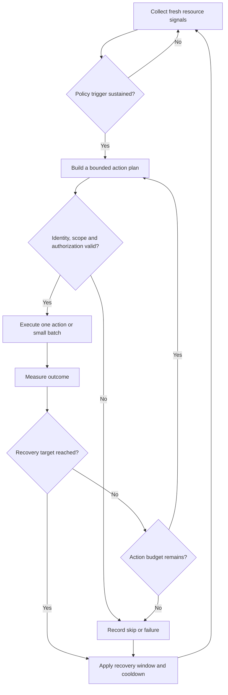
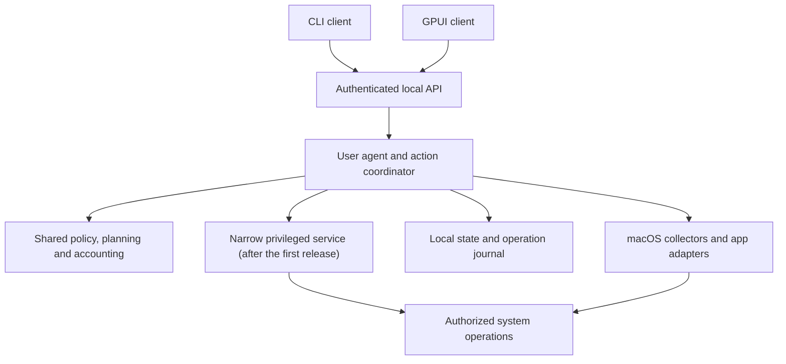

# Svalnir

**A proactive macOS resource manager built in Rust, with a CLI first and a GPUI desktop interface.**

Svalnir is designed to keep a Mac usable when storage, memory, and background workloads compete for limited resources. It brings disk analysis, explainable cleanup, continuous monitoring, and application resource control into one local application.

The background agent watches available disk capacity, system memory pressure, swap activity, and application resource usage. Under an explicitly enabled policy, it can automatically evict approved regenerable files, terminate applications that exceed their memory budgets, and force quit eligible applications during sustained critical memory pressure.

**Project status: design specification with a Milestone 2 build that is not validated, with release artifacts that have no Developer ID signature and no notarization.** This README describes the intended product and its proposed interfaces. The repository contains a Cargo workspace with five crates. The `svalnir` CLI runs the read-only commands in its own process: resource status, the process inventory, bounded scans, capability diagnostics, configuration validation, and policy simulation. It also runs the Milestone 2 commands that change state: manual cleanup plans in the Trash and the permanent mode, the stop of one process or of the verified members of one application group, operation queries and cancellation, configuration activation, policy enablement, pause and resume, the history, and the registration of the agent as a per-user service. The libraries have the operation journal, the coordinator, the filesystem and process executors, the guard controller, and the agent runtime; the `svalnir-agent` binary runs the agent in the foreground. A client and the agent share the journal: there is no socket, and no XPC service is registered. A part of Milestone 3 is in code and not validated: the eviction path of the disk guard, which runs only in fixture tests; the GPUI client with seven screens, of which Memory, Applications, and Automation show the readings of the agent records, and the state-changing actions of three of them through the journal: authority record writes, also with no agent, and requests to a running agent; a menu bar item with the same readings and the same pause control; the helper side of the helper protocol, which nothing calls; and the scripts that make and check the release artifacts. Still planned: Developer ID signing and notarization, the signed local protocol, a host validation of the urgent dialog of an installed signed agent and of the menu bar item of the GPUI client in the dark menu bar, with Increase Contrast, and with VoiceOver, and the promotion of a cleanup rule. The privileged helper has no operation in the first release (owner decision of 2026-11-19): its installation and its validation come after the release. Each reviewed rule is in the `proposed` lifecycle state, so no eviction, automatic or manual, is permitted. `policy rearm` needs a running agent: the controller of the agent records the new budget generation. Nothing here is validated against the release gates of [VALIDATION.md](docs/VALIDATION.md): the collectors, the commands, and the executors have unit and fixture tests only. This README does not claim that a downloadable release, package, or benchmark already exists. Commands, configuration keys, crate boundaries, and milestones below are a coordinated starting specification and may evolve during implementation.

## Contents

- [Design specifications](#design-specifications)
- [Product goals](#product-goals)
- [Planned capabilities](#planned-capabilities)
- [How protection works](#how-protection-works)
- [Disk analysis and accounting](#disk-analysis-and-accounting)
- [Automatic disk protection](#automatic-disk-protection)
- [RAM and swap monitoring](#ram-and-swap-monitoring)
- [Automatic application control](#automatic-application-control)
- [Developer workflows](#developer-workflows)
- [Command-line interface](#command-line-interface)
- [Configuration and policies](#configuration-and-policies)
- [GPUI desktop experience](#gpui-desktop-experience)
- [Architecture and Rust stack](#architecture-and-rust-stack)
- [Permissions and privileged operations](#permissions-and-privileged-operations)
- [Background service lifecycle](#background-service-lifecycle)
- [Advanced capabilities](#advanced-capabilities)
- [Reliability and recovery](#reliability-and-recovery)
- [Privacy and local data](#privacy-and-local-data)
- [Platform and distribution](#platform-and-distribution)
- [Development and validation](#development-and-validation)
- [Roadmap and release criteria](#roadmap-and-release-criteria)
- [License](#license)

## Design specifications

Each document owns one contract. Where a specification is more specific than this README, the specification takes precedence. All of them describe required behavior, not an implementation.

| Document | Owns |
| --- | --- |
| [Architecture](docs/ARCHITECTURE.md) | Components, coordination, persistence, and cross-component invariants |
| [Threat model](docs/THREAT_MODEL.md) | Trust boundaries, threats, required controls, and residual risks |
| [Resource model](docs/RESOURCE_MODEL.md) | Metric definitions, units, identities, freshness, and aggregation |
| [Policy specification](docs/POLICY_SPEC.md) | Configuration validation, triggers, incidents, budgets, and recovery |
| [Action contracts](docs/ACTION_CONTRACTS.md) | Plans, admission, execution states, outcomes, and crash recovery |
| [Cleanup rules](docs/CLEANUP_RULES.md) | Rule declaration, eligibility, the proposed registry, and promotion |
| [Interfaces](docs/INTERFACES.md) | CLI, JSON/NDJSON output, exit status, local IPC, and GPUI parity |
| [Validation plan](docs/VALIDATION.md) | Validation families, release gates, and evidence records |
| [Design](DESIGN.md) | Visual language of the GPUI client: tokens, surfaces, components, data visualization, and motion |

[ROADMAP.md](ROADMAP.md) gives the milestones and the acceptance criteria of the first release. [CONTRIBUTING.md](CONTRIBUTING.md) gives the contribution workflow. [AGENTS.md](AGENTS.md) and [CLAUDE.md](CLAUDE.md) give instructions for automated contributors.

## Product goals

Svalnir should answer four practical questions:

1. **What is consuming resources?** Attribute storage and memory usage to applications, developer tools, projects, and identifiable processes.
2. **What can be reclaimed?** Explain each candidate, its estimated benefit, its owner, and the consequences of removing it.
3. **What should happen automatically?** Apply standing policies before resource exhaustion makes the system difficult to use.
4. **Did the action help?** Measure the outcome, retain a concise history, and stop ineffective cleanup or termination loops.

The intended audience includes developers running IDEs, build systems, simulators, containers, browsers, and local AI workloads, as well as users who want consistent resource protection without repeatedly opening a cleanup application.

### Design principles

- **CLI completeness.** Inspection, configuration, cleanup, and protection must work without opening the GUI.
- **One policy engine.** The CLI, GUI, and background agent share the same decisions, exclusions, and operation records.
- **Explainable automation.** Every action identifies its trigger, policy revision, target, expected effect, and observed result.
- **Explicit standing authorization.** Enabling a policy grants permission for its defined actions; routine incidents do not require another prompt.
- **Resource awareness.** Svalnir limits its own memory, CPU, disk I/O, database growth, and work queues.
- **Accurate accounting.** Estimates, unavailable measurements, and observed capacity changes remain distinct.
- **Local operation.** Monitoring and protection work offline. No cloud service or language model is required.
- **Visible control.** Users can pause automation, inspect pending actions, protect applications, and disable policies from either interface.

Svalnir does not promise that every cache is disposable or that every large application is malfunctioning. Its rules encode the conditions under which a particular action is appropriate.

## Planned capabilities

“First release” means the initial usable product target, not functionality already shipped.

| Area | First release target | Later extensions |
| --- | --- | --- |
| Disk analysis | Volume overview, directory sizes, application and developer categories, large-file discovery, partial-scan reporting, invalidation of the candidate catalog from filesystem events | Duplicate review, a report of capacity outside the scanned categories, richer storage attribution and historical comparisons |
| Manual cleanup | Previewable, expiring plans; exclusions; Trash or explicitly selected permanent removal | Additional application adapters and uninstall assistance |
| Disk protection | Persistent monitoring and automatic eviction of approved regenerable files under low-space policies | More workload-aware preparation and forecasting |
| Memory monitoring | System pressure, RAM composition, compression, swap usage and activity, process footprint and growth | Deeper diagnostic views and optional hardware metrics |
| Application control | Automatic graceful termination and force quit; per-app budgets; protected identities; cooldowns | More cooperative application integrations |
| Developer tools | Initial audited cleanup adapters, with the package and build caches of the [rule registry](docs/CLEANUP_RULES.md), and recognition of common workload owners | Project dependency directories, simulator, container, and Homebrew operations through the owner tool, manual Git worktree cleanup, managed job runner, model lifecycle adapters |
| Interfaces | Full CLI, structured output, core GPUI dashboard, menu bar status, notifications | Richer storage visualization and diagnostic timelines |
| Permissions | Capability diagnostics, Full Disk Access guidance | Narrow privileged helper, optional system extensions |
| Operations | Local history, policy simulation, pause/resume, crash recovery, bounded retention | Fleet-oriented configuration and export formats, if justified |

Automatic force termination belongs to the first release scope. It is an enabled-policy behavior with configurable eligibility and escalation, not merely a notification feature.

## How protection works

The agent combines event notifications with bounded periodic sampling. Filesystem events invalidate affected catalog entries (in code and not validated; see [Automatic disk protection](#automatic-disk-protection)); memory-pressure notifications prompt a fresh assessment. Startup, wake, volume changes, and policy changes also trigger reconciliation.

The controller evaluates disk and memory together. During simultaneous critical disk and memory pressure, it first reduces its own work, uses already known cleanup candidates, and considers eligible memory-heavy applications. It avoids launching an expensive full-disk scan or hashing job in the middle of an emergency.



The controller distinguishes **normal**, **warning**, **acting**, **recovering**, and **degraded** states. Disk thresholds and macOS memory-pressure levels feed this controller independently; a single combined percentage does not replace either signal.

A warning can prepare candidates and notify the user. An action requires a fresh measurement, an applicable enabled policy, an eligible target, and remaining action budget. Recovery requires a stable interval before normal background work resumes.

These five states are a summary for presentation. The [policy specification](docs/POLICY_SPEC.md) defines the incident states, qualification windows, and budgets.

## Disk analysis and accounting

### Understand where space goes

The scanner should support:

- APFS volume and container relationships, mount points, and the scope of each scan.
- Directory trees, large files, old build outputs, and known cache categories.
- Application bundles, associated data, and developer workspaces where attribution is supported.
- Excluded paths, inaccessible directories, interrupted scans, and stale catalog entries.
- Separate scan and cleanup views: a large item can be visible without being eligible for removal.

The default scan remains within the selected filesystem boundary. Crossing mount points, following explicitly selected external volumes, or inspecting additional users requires a deliberate scope change. Symlinks are recorded without recursively following them by default.

### Report the right size

| Measurement | Meaning in Svalnir |
| --- | --- |
| Logical size | Length of file content as reported by the filesystem |
| Allocated size | Storage reported as allocated to the file; not necessarily exclusively owned blocks |
| Exclusive allocation | A separately qualified value, available only when the platform and adapter can establish it |
| Estimated reclaimable size | A rule-specific estimate of capacity an action may release |
| Trashed size | Content moved to Trash; not a claim that disk capacity was freed |
| Observed capacity change | Before/after change in available capacity, with timestamp and measurement source |

Hard links, APFS clones, snapshots, compression, sparse files, and open file descriptors complicate reclamation estimates. Summing allocated sizes does not establish how much unique storage can be recovered. Exact exclusive allocation is allowed to be unavailable. On APFS, the scanner reports the private allocated bytes of a unit: the sum of the bytes that only each file uses. This is a lower figure, and the reclaim estimate uses only it. The shared blocks of clone families that are complete in the unit are a separate figure that is not a reclaim figure ([RESOURCE_MODEL.md](docs/RESOURCE_MODEL.md) section 8).

The baseline filesystem sample uses the appropriate `statfs` fields, including `f_bavail * f_bsize` for available bytes under that interface's semantics. Foundation's capacity estimates for important and opportunistic usage are additional, explicitly labeled signals. They must not be silently presented as already-free physical space. See [statfs][statfs] and [Apple's capacity guidance][capacity].

For APFS volumes that share a container, Svalnir must not add each volume's available capacity as if it were independent storage. Volume quotas, reserves, and the system's Data/VM relationship also matter when explaining why disk availability and swap activity interact. See [APFS space management][apfs-volumes] and [Apple's volume layout][apfs-layout].

A live before/after change includes other applications' activity. The UI should say “available capacity increased by…” rather than attributing every changed byte to Svalnir.

The [resource model](docs/RESOURCE_MODEL.md) defines each measurement, its source, and its unit.

## Automatic disk protection

The disk guard runs while the graphical application is closed. It prepares a compact catalog during normal operation and refreshes affected areas when necessary. FSEvents is an invalidation mechanism; coalesced or dropped events require reconciliation and must not be treated as a complete per-file audit log. See [Apple's FSEvents guidance][fsevents].

The first release has the FSEvents invalidation of the candidate catalog (owner decision of 2026-11-20, which replaces the decision of the same day that the release has no FSEvents consumer). The agent refreshes its candidates with a bounded discovery in the warning band of the disk guard, and an event marks a region of an approved root for that discovery. The build has this consumer; it is not validated on a host.

### Trigger and recovery policy

A policy combines:

- A warning threshold for preparation and notifications.
- A lower reclaim threshold with a sustained-duration requirement.
- An emergency threshold that can shorten that waiting period.
- A higher recovery target to prevent repeated threshold crossings.
- Per-batch, per-pass, and per-rule limits.
- Cooldowns and backoff when actions produce little useful recovery.

Available-capacity trends can estimate time to a threshold. That estimate should trigger preparation, not independently authorize deletion. Disk-write throughput alone is not a reliable net-space forecast.

The [configuration example](#configuration-and-policies) illustrates these relationships. Its numbers are tuning examples, not macOS recommendations or universal defaults.

### What automatic cleanup can remove

An automatic cleanup adapter must identify specific regenerable data and prove the relevant eligibility conditions as far as its integration permits.

| Candidate | Intended handling |
| --- | --- |
| Expired Svalnir-owned temporary data | Eligible under Svalnir's own retention contract |
| Audited application caches | Eligible after rule approval, required age, owner/activity checks, and exclusions |
| Selected build outputs and package caches | Eligible only through a tool-specific adapter with workspace and lock checks |
| Rotated logs | Manual review by default; automatic only under an explicit retention contract |
| Downloads, documents, media, archives, backups | Manual selection; excluded from default automatic policies |
| App containers, databases, simulator data, virtual disks, model weights | Protected unless a specific integration offers a separately approved lifecycle operation |
| Swap files, protected system data, Time Machine snapshots | Outside automatic cache eviction |

Being inside a directory named `Caches`, having an old timestamp, or belonging to a developer tool is insufficient proof. Access time alone is not a reliable activity test.

A rule records its ID and version, approved roots, supported application/tool versions, owner identity, minimum age, lock and activity checks, exclusions, deletion method, expected rebuild cost, possible network requirements, and action budgets. Ambiguous ownership or unsupported layouts produce a skip. The [cleanup rules](docs/CLEANUP_RULES.md) document defines the rule declaration, the proposed registry, and the evidence that a rule needs before it can act automatically.

### Trash and permanent eviction

Manual cleanup defaults to moving selected content to Trash when supported. Automatic low-space protection uses **permanent eviction of explicitly approved regenerable data**, because moving content to Trash does not itself free the occupied storage. Svalnir never interprets a cleanup policy as permission to empty the user's entire Trash. See [Apple's storage guidance][trash-space].

These modes have separate authorization and presentation. A permanent eviction record is an audit trail, not an undo copy. Creating a same-volume backup of everything before an emergency eviction would also defeat the recovery goal.

### Execution contract

Before each batch, the executor rechecks target identity, volume, rule version, scope, permissions, activity, and policy authorization. Filesystem operations should use directory-relative handles and no-follow protections where available. A path check followed by an unrelated recursive delete is insufficient protection against concurrent path replacement.

After each batch, the agent samples capacity again. Open files and retained snapshot blocks may prevent an immediate increase even after a successful unlink; [unlink semantics][unlink] explain one such case. Low benefit triggers backoff or another already-authorized candidate. It never expands the policy to personal files. The [action contracts](docs/ACTION_CONTRACTS.md) define admission, execution states, and outcomes for each action class.

## RAM and swap monitoring

Memory monitoring is designed around responsiveness and sustained pressure.

### System signals

The intended collector combines:

- macOS memory-pressure notifications and their normal, warning, and critical states.
- Physical memory capacity and VM statistics.
- Resident, wired, compressed, and other relevant quantities, with definitions matching their source.
- Swap usage and allocation, plus swap-in and swap-out activity over time.
- Sampling freshness, counter resets, unavailable values, and permission failures.

Dispatch exposes a system memory-pressure event source. Apple also describes memory pressure as a combination of factors rather than a simple used-memory percentage. These are the basis for the global guard. See [Dispatch memory pressure][memory-pressure] and [Activity Monitor memory guidance][activity-memory].

Native collectors can use `host_statistics64`, `HOST_VM_INFO64`, `hw.memsize`, and `vm.swapusage`, behind a tested macOS adapter. Page-based counters must use the runtime page size. Physical compressor storage and the logical amount represented by compressed pages remain different measurements. See [XNU VM statistics][vm-statistics] and [sysctl definitions][sysctl].

Swap-in/out rates use deltas of the corresponding swap counters and a monotonic interval. A page-equivalent byte rate is not an exact measurement of physical SSD traffic. Page-ins/page-outs must not be relabeled as swap-ins/swap-outs.

### Process and application signals

For each accessible process, Svalnir should expose:

- Stable observation identity: PID, start time, UID, executable identity, and app/job association.
- Physical footprint where supported, RSS, recent growth, CPU usage, and available I/O statistics.
- Foreground/background status when attributable to an application.
- Parent and helper relationships, with an explicit confidence level.
- The active resource policy and reason a process is protected, eligible, or unavailable.

Physical footprint and RSS are different quantities. Footprint can account for dirty, compressed, and swapped memory, and relevant GPU allocations; it is not a synonym for currently resident RAM. Application totals are estimates when shared resources or incomplete attribution prevent exact accounting. See [Apple's memory analysis session][memory-footprint] and [Metal memory guidance][metal-memory].

Native macOS collectors supply the process inventory and the memory metrics. A resident-size value must not be renamed to macOS physical footprint. Missing or restricted metrics appear as **unavailable**, **stale**, or **unknown**, never as a fabricated zero.

### What swap management means

Svalnir manages the workloads that create pressure and reports the system's swap behavior. It does not promise an exact swapped-byte count for every PID, an immediate reduction of swap usage after an application exits, or a user-configurable hard swap ceiling.

Nonzero swap can be normal. The guard does not delete swap files, disable macOS virtual memory, or run a generic “RAM purge” routine. Its success criteria are lower sustained pressure and recovered responsiveness, not an empty swap counter.

## Automatic application control

Svalnir can automatically stop applications and jobs under two independent conditions:

1. **Global pressure protection:** sustained critical system memory pressure, fresh corroborating metrics, and an eligible target.
2. **Application budget enforcement:** an application remains above its configured footprint stop threshold for the configured duration, even when global pressure is normal.

A growing footprint can identify a suspected leak or runaway workload; it does not prove a leak. High CPU usage alone does not trigger the memory guard. Separate workload policies may later address CPU, thermal, or energy constraints.

### Protection profiles

| Profile | Automatic behavior |
| --- | --- |
| Observe | Collect, explain, and notify; take no resource-reclaiming action |
| Balanced | Reclaim approved caches and stop eligible background user applications or managed jobs; protect the foreground application |
| Aggressive | Use shorter configured grace periods and optionally include foreground applications; retain hard-protected system identities |

Profiles are policy templates. Enabling automatic eviction or force quit requires acknowledging those action classes once. Administrative access or Full Disk Access alone does not enable them.

Users can protect applications, prioritize disposable jobs, assign budgets, and override category defaults. Hard protection covers critical OS processes, session infrastructure, Svalnir's agent/helper, and any identity whose termination would undermine safe operation. The actual catalog must be versioned and validated, not implemented as a handful of name comparisons.

### Select and stop a target

Eligible candidates are ranked using policy priority, registered restartability, budget violation, footprint, growth, foreground status, and application attribution. Svalnir normally prefers disposable managed workloads and specifically configured applications before broadly eligible background applications.

The escalation sequence is:

1. Reduce Svalnir's own optional work.
2. Use a supported cooperative action, such as unloading an idle model, when applicable.
3. Request graceful application termination or send the configured graceful signal to a verified job.
4. Wait for the configured grace period.
5. Force quit or send `SIGKILL` if the policy authorizes escalation and the same target is still present.
6. Verify exit, sample memory pressure again, and wait through an observation window before choosing another target.

For GUI applications, `NSRunningApplication.terminate()` and `forceTerminate()` provide application-level operations. Their return values do not replace observing actual exit; a force-termination call may return before the application exits. An already-exited target is a separate successful outcome, not a reason to retry. See [terminate][app-terminate], [forceTerminate][app-force-terminate], and [isTerminated][app-terminated].

A dedicated policy can authorize immediate force termination for a disposable workload. The ordinary profile still gives applications a chance to exit. Force termination can lose unsaved work; this consequence belongs in policy setup and action history, not in a prompt that blocks every emergency.

### Identity, grouping, and restart control

A PID alone is not a durable target identity. The executor revalidates PID, start time, ownership, executable identity, and app/job association immediately before signaling. This reduces PID-reuse errors, although conventional PID-based signal APIs do not provide an atomic, universally race-free identity guarantee.

An application, a descendant tree, a POSIX process group, and a shared service are different groups. Svalnir must not terminate every process named `node`, `java`, or `python`, or every executable from the same signing team. Shared XPC services require separate attribution. A list of running GUI apps also does not cover all system processes. See [NSWorkspace application enumeration][running-apps].

Managed jobs can establish known process groups and explicit child tracking. That helps lifecycle control but does not create a general security sandbox or hard RAM quota. Suspending a process with `SIGSTOP` does not release its memory, and changing scheduling priority does not impose a memory limit.

Restart behavior is explicit: never, after stable recovery, or after a cooldown. Maximum attempts and an incident-wide termination budget prevent kill/relaunch loops. A supervised service may immediately restart after termination; an integration must coordinate with its supervisor where supported.

## Developer workflows

Developer adapters connect resource attribution to the tool that owns the data or process.

| Workload | Planned analysis and control |
| --- | --- |
| Xcode and simulators | Attribute DerivedData and supported caches; detect active builds; keep archives, dSYMs, device data, and simulator contents outside generic eviction |
| Gradle and Android tooling | Explain cache/build ownership; respect active daemons and locks; offer supported heap/worker configuration as a separate action |
| Rust projects | Identify workspace build outputs and toolchain caches; avoid deleting an actively used target tree |
| JavaScript tooling | Distinguish package caches from project dependencies, lockfiles, and source; prefer tool-supported operations |
| Docker and other VMs | Attribute VM disk and memory use; distinguish host pressure from guest limits; keep persistent volumes and databases protected |
| Local model runtimes | Show model process footprint; unload idle models through supported APIs; retain model weights unless explicitly selected |
| Git worktrees | Later: list the linked worktrees of a repository; manual removal only, with uncommitted work shown and preserved first |
| Managed builds and scripts | Later: launch a registered job with an identity, budget, priority, stop policy, and restart policy |

An adapter may suggest configuring a workload before it starts, such as Gradle heap/worker settings or Docker Desktop's VM resource settings. It should not silently rewrite global developer configuration. Ollama's documented lifecycle controls provide an example of releasing loaded model memory without deleting model files. See [Gradle build environment][gradle-environment], [Gradle configuration][gradle-config], [Docker resource settings][docker-settings], and [Ollama FAQ][ollama-faq].

A future `svalnir run` interface would make job ownership and termination predictable. It would enforce application-level policies, not claim to provide Linux cgroup semantics on macOS.

## Command-line interface

### Selected framework

The CLI will use **`clap` with its derive API**, plus `clap_complete` for shell completions. Its typed argument model, nested subcommands, validation, and generated help fit Svalnir's operational command surface. Parsing remains separate from policy and execution logic. A terminal dashboard can be added later without making it a dependency of ordinary commands. See [clap][clap] and [clap_complete][clap-complete].

### Proposed command surface

| Command | Purpose |
| --- | --- |
| `svalnir status` | Summarize disk, memory, agent, and policy state |
| `svalnir scan PATH` | Analyze a selected storage scope |
| `svalnir report --scan ID` | Inspect a recorded scan |
| `svalnir disk [--warn-below SIZE]` | Show the free and available space of the volume of the home directory; with `--warn-below`, warn only when space is low |
| `svalnir clean inspect` | Inspect the units of one cleanup rule; read-only |
| `svalnir clean plan` | Prepare a bounded cleanup plan |
| `svalnir clean show --plan ID` | Explain targets, estimates, exclusions, and expiry |
| `svalnir clean apply --plan ID` | Revalidate and execute an authorized plan |
| `svalnir monitor` | Stream live resource observations |
| `svalnir memory status` | Show pressure, memory composition, and growth signals |
| `svalnir swap status` | Show global swap usage and recent activity |
| `svalnir processes top` | Rank applications or processes by a selected metric |
| `svalnir processes show --target ID` | Explain a target and its policy eligibility |
| `svalnir processes stop --target ID` | Request termination of a verified target |
| `svalnir processes stop --group INSTANCE_ID` | Request termination of the verified members of one application or managed-job instance |
| `svalnir operations show/wait/cancel/acknowledge` | Query an admitted operation, wait for its result, stop its later steps, or acknowledge an unknown outcome and release its leases |
| `svalnir agent install/status/pause/resume/uninstall` | Manage Svalnir's own background service |
| `svalnir policy list/show/enable/disable/simulate/rearm` | Inspect and manage standing policies and incident allowance |
| `svalnir config validate/show/apply` | Validate a proposal, show effective values, and activate a revision |
| `svalnir history` | Inspect actions and observed outcomes |
| `svalnir doctor` | Diagnose permissions, service identity, APIs, and degraded state |
| `svalnir completions SHELL` | Generate shell completions |
| `svalnir license` | Display the GPLv3 license and applicable notices |
| `svalnir mcp` | Serve the Model Context Protocol on stdin and stdout for a coding agent |

Future namespaces may include `apps`, `services`, `run`, `volumes`, and `power`. They are not prerequisites for the core guards. The [interfaces](docs/INTERFACES.md) document defines the common options, output encoding, exit status, and the local protocol.

### Inspect and clean

```sh
# Inspect capabilities before granting additional access.
svalnir doctor
svalnir status --format json

# Create a scan and use its returned scan ID.
svalnir scan "$HOME" --save
svalnir report --scan SCAN_ID

# List the candidates of the scan, then prepare a manual cleanup in Trash
# mode of the entries that you name.
svalnir clean plan --scan SCAN_ID --mode trash
svalnir clean plan --scan SCAN_ID --mode trash --entry ~/Library/Caches/com.example.app
svalnir clean show --plan PLAN_ID
svalnir clean apply --plan PLAN_ID

# Inspect memory and stream machine-readable observations.
svalnir memory status
svalnir swap status
svalnir processes top --sort footprint --format json
svalnir monitor --format ndjson
```

`SCAN_ID`, `PLAN_ID`, and target IDs are placeholders for identifiers returned by Svalnir. Plans bind to targets, policy/rule revisions, selected action modes, and an expiry. Applying a plan consumes it; retries inspect the recorded operation instead of blindly repeating deletion.

The manual cleanup modes are `trash` (move selected entries to Trash), `permanent` (permanently delete selected entries), and `evict` (permanently remove candidates of one reviewed rule). Each mode needs its own authorization.

Read-only commands do not authorize cleanup. A plan can be created and examined without mutation. Interactive apply shows its scope; noninteractive apply requires `--yes` or an applicable standing authorization. `--yes` does not override exclusions, failed identity checks, or a stale plan.

### Enable continuous protection

```sh
# Install the user-session agent in observation mode.
svalnir agent install
svalnir config validate
svalnir policy show disk-guard
svalnir policy show memory-guard

# Review proposed actions against current observations.
svalnir policy simulate disk-guard
svalnir policy simulate memory-guard

# Enable the reviewed action classes as standing policies. A memory guard
# that does not permit a force quit takes --accept-application-exit.
svalnir policy enable disk-guard --accept-permanent-eviction
svalnir policy enable memory-guard --accept-force-quit

# Inspect or temporarily pause automatic intervention.
svalnir agent status
svalnir history --limit 20
svalnir agent pause --for 1h
svalnir agent resume
```

Enabling a guard is a separate step from registering the background item. Once enabled, eligible incidents proceed automatically within the reviewed policy. Expanding eligible roots, action classes, or protected-target exceptions requires another policy review.

Pausing suspends new automatic interventions while keeping lightweight monitoring available. An already issued termination request cannot be undone; a cleanup operation stops at its next safe batch boundary. Resuming always refreshes measurements.

### Manual process control

```sh
svalnir processes show --target TARGET_ID

# Request a normal exit, then escalate if the target remains alive.
svalnir processes stop --target TARGET_ID --grace 10s --force-after-timeout

# Explicit immediate force termination of an eligible reviewed target.
svalnir processes stop --target TARGET_ID --force
```

Manual commands use the same identity validation and hard protections as automation. A process budget is a sampled enforcement policy with possible overshoot, not a kernel-enforced allocation ceiling.

### Coding agents

#### Disk space

```sh
# The free and available space of the volume of the home directory.
svalnir disk
svalnir disk --format json

# A check for a script or a hook: one warning line when less than 20 GiB is
# available, and no output otherwise.
svalnir disk --warn-below 20GiB
```

With `--warn-below`, an error goes to stderr and the exit status is `0`, so a hook does not fail. A size has a binary unit only: `B`, `KiB`, `MiB`, `GiB`, or `TiB`. A decimal unit such as `20GB` is an error: the command then prints nothing on stdout and one `error:` line on stderr.

#### MCP server

`svalnir mcp` is a Model Context Protocol server on stdin and stdout. Add it to Claude Code:

```sh
claude mcp add svalnir -- svalnir mcp
```

The tools are `disk`, `scan`, `report`, `inspect`, `plan`, `show`, `apply`, and `operations`. Each tool runs the CLI command of the same name, with the same checks. `apply` is `svalnir clean apply` and needs the digest that `plan` or `show` returned. It applies only `evict` and `trash` plans, and only a running agent executes them: with no agent, `apply` is refused with `agent_not_running`, and the server never executes a step itself. The descriptions of the tools tell the agent to show each plan to the user and to ask for approval before `apply`. The server cannot verify that approval. The lifecycle gates of the rules, the protections, the digest of the plan, and the journal stay in effect ([THREAT_MODEL.md](docs/THREAT_MODEL.md) section 7). The server has no `permanent` mode, and no tool that enables a guard or stops a process. [INTERFACES.md](docs/INTERFACES.md) section 17 has the contract.

#### Agent skill

[`skills/svalnir/SKILL.md`](skills/svalnir/SKILL.md) tells a coding agent when to use Svalnir and how to apply a plan only after the user approves it. Copy it to the skills directory of Claude Code:

```sh
mkdir -p ~/.claude/skills/svalnir
cp skills/svalnir/SKILL.md ~/.claude/skills/svalnir/SKILL.md
```

#### Hooks

This Claude Code `SessionStart` hook gives the agent a warning when less than 20 GiB is available. Add it to `~/.claude/settings.json`:

```json
{
  "hooks": {
    "SessionStart": [
      {
        "hooks": [
          {
            "type": "command",
            "command": "svalnir disk --warn-below 20GiB"
          }
        ]
      }
    ]
  }
}
```

The hook prints nothing when the space is sufficient, and it does not stop the session when Svalnir gives an error. Give the size with a binary unit (`20GiB`): with `20GB` the hook prints nothing, and the error goes to stderr.

### Output contract

- Human-readable tables are the interactive default.
- `--format json` emits a versioned snapshot; `--format ndjson` emits one event per line for streaming commands.
- Machine output includes timestamps, units, source/freshness, operation IDs, and structured errors.
- Diagnostics go to stderr; JSON and NDJSON on stdout contain no progress bars or ANSI decoration.
- Partial scans preserve successful results while identifying unreadable or stale areas.
- Stream cancellation disconnects the client; it does not implicitly uninstall the agent or cancel an unrelated background operation.

Proposed exit codes are `0` for success, `1` for an operation failure, `2` for invalid arguments/configuration, `3` for missing capability or authorization, `4` for partial results or a partial or incomplete operation, `5` for stale/conflicting state or an unknown outcome, `130` for user interruption, and `143` or `129` for a client that executed an operation as a transient coordinator and stopped on `SIGTERM` or `SIGHUP`. A policy simulation can succeed while reporting that all candidates were skipped. A status query exits with `0` when the query succeeds, even if the operation that it reports failed. [INTERFACES.md](docs/INTERFACES.md) has the full exit-status contract.

## Configuration and policies

The intended default user configuration path is:

```text
~/Library/Application Support/Svalnir/config.toml
```

Machine-level helper configuration is separate, administrator-owned, and cannot be broadened through an untrusted per-user file. The CLI can select another configuration file as a proposal with `--config PATH` for validation and simulation. That option does not activate the file; `svalnir config apply` activates a validated revision.

The following is an **illustrative proposed schema**, not a shipped default. Storage thresholds suit neither every disk nor every workload. The example application identity must be replaced with a real, verified target. The [policy specification](docs/POLICY_SPEC.md) has the complete example with the explicit limits, timing fields, and validation rules.

```toml
schema_version = 1

[agent]
profile = "balanced"
sample_interval = "60s"
pressure_sample_interval = "5s"

[disk_guard]
enabled = true
volumes = ["startup-data"]
warn_below = "20GiB"
reclaim_below = "10GiB"
emergency_below = "2GiB"
recover_above = "25GiB"
sustain_for = "30s"
recovery_stable_for = "60s"
batch_limit = "1GiB"
pass_limit = "8GiB"
pass_time_limit = "30s"
no_effect_backoff = "15m"
automatic_mode = "permanent"
approved_rules = ["svalnir.expired-temporary", "xcode.inactive-derived-data"]

[disk_guard.exclusions]
paths = ["~/Documents", "~/Downloads", "~/Pictures", "~/Movies"]
protect_archives = true
protect_backups = true
protect_databases = true
protect_model_weights = true

[memory_guard]
enabled = true
global_trigger = "critical"
sustain_for = "15s"
grace_period = "10s"
observe_after_action = "15s"
recovery_stable_for = "60s"
max_applications_per_incident = 3
protect_foreground = true
allow_force_quit = true
allow_volatile_journal_on_critical = false
eligible_groups = ["background-user-applications", "managed-jobs"]
protected_bundle_ids = []
protected_executable_paths = []

[[memory_guard.app_budgets]]
id = "example-build-worker"
bundle_id = "com.example.BuildWorker"
footprint_soft = "4GiB"
footprint_stop = "6GiB"
over_limit_for = "30s"
cooldown = "10m"
restart = "never"

[history]
retention = "30d"
max_database_size = "256MiB"
redact_exported_paths = true

[privacy]
telemetry = false
include_command_arguments = false
```

### Configuration semantics

- `enabled` requests an active policy; the required action-class authorization must also exist.
- `approved_rules` names reviewed adapters, not arbitrary directory globs. Unknown or unsupported rules fail validation.
- `startup-data` is a proposed logical selector resolved to the current volume identity.
- Explicit `~/` expansion is supported in user paths; shell evaluation and command substitution are not.
- Built-in hard exclusions and process protections remain effective even when an example list is empty.
- Disk thresholds must preserve the intended ordering: emergency below reclaim, reclaim below warning, and recovery above warning.
- Batch and pass limits bound planned work; indivisible candidates that exceed a remaining budget are skipped.
- A soft footprint threshold emits an advisory signal. The stop threshold and sustained duration authorize action only when the policy permits it.
- Resource durations use a monotonic clock. Sleep and counter discontinuities reset relevant observation windows.
- Policy changes are validated atomically, versioned, and recorded. Actions revalidate against the effective policy before execution.
- Retention is best effort within hard size limits; maintaining system availability takes precedence over retaining every historical sample.

Policy simulation explains which targets would be eligible at the current snapshot and why. It cannot guarantee that a later real operation sees the same files, processes, or available capacity.

## GPUI desktop experience

The desktop interface will use [GPUI][gpui] while sharing the agent's models and policies with the CLI. Closing a window does not stop protection.

The initial interface should provide:

- **Overview:** current disk headroom, memory pressure, swap activity, active policies, and the latest intervention.
- **Storage:** volume-aware breakdown, directory navigation, cleanup explanations, exclusions, and previewable plans.
- **Memory:** pressure timeline, compression and swap context, application footprint, growth, and budget status.
- **Applications:** verified app/helper grouping, protection rules, termination controls, and restart history.
- **Automation:** policy configuration, simulation, pause state, and the exact authorized action classes.
- **History:** reasons, skipped targets, permanent versus Trash operations, and measured outcomes.
- **Diagnostics:** permissions for the actual running components, service state, and unsupported capabilities.

A menu bar item provides compact status and pause/resume. The research step of the owner decision found no status item API in `gpui-kit` or GPUI, so the item is an `AppKit` status item in the GUI process ([INTERFACES.md](docs/INTERFACES.md) section 4). Notifications explain meaningful state changes without repeatedly alerting on the same sustained condition. The agent posts them, so they do not need an open window (owner decision of 2026-11-19). In the first release the agent shows a system dialog (`CFUserNotification`) only for critical memory pressure, an exhausted incident budget, and an automatic operation that did not complete, with a timeout of 60 s; banners through a nested application of the bundle come after the first release (owner decision of 2026-11-20). The User Notifications framework does not deliver for a launchd agent. The dialog of the current build is not validated ([INTERFACES.md](docs/INTERFACES.md) section 4).

[DESIGN.md](DESIGN.md) specifies the visual language, the components, and the motion of these screens.

The current client has the seven screens. By the owner decision of 2026-11-19, its state-changing actions use the journal, as the CLI does ([INTERFACES.md](docs/INTERFACES.md) section 4). Automation has pause and resume, and enable and disable of each guard, with a confirmation that names the revision and the action classes; it also has rearm of an open incident of the controller reading. History has cancel of an operation that is not settled and acknowledge of an `UnknownOutcome` operation. Applications has the stop of a group that the catalog does not protect, as a quit or a force quit, with a confirmation that lists each bound process in a list that scrolls. Pause, resume, enable, and disable write the authority record directly also with no agent, as the CLI does; with no state directory or no journal, the window makes the private state directory and the journal for a pause, a resume, and a disable, as the CLI does, and refuses an existing state directory that is not private; an enable with no journal is refused, as in the CLI, and makes nothing. Rearm, cancel, acknowledge, and stop need a running agent: with none, the control is not available and the client writes nothing. A stop that the agent does not admit in 10 s stays in the state Waiting for admission until 30 s after its plan expires. The window has at most one stop confirmation at a time. Memory, Applications, and Automation show the application budgets, the cooldowns, the usage of each open incident, and the pause as the agent decides it, from the agent records in the journal. History has a detail view of an operation, a filter, and a sort order. Diagnostics has two labeled lists: the capability summary of the agent from its status record, and the probes of the window process. The client posts no system notification ([INTERFACES.md](docs/INTERFACES.md) section 4). It has no policy configuration, no simulation, no exclusion editor, and no cleanup plan. The client also has a menu bar item that is not validated: the inline capacity grid and the memory pressure state in the menu bar, and a menu with the used space, the pressure, the agent state, the pause state, the pause control of Automation through the same path, Open Svalnir, and Quit Svalnir. The item reads the model of the window, also while no window is open, and with the item the client continues to run when its last window closes, with no Dock icon until a window opens again. The item is on by default, and `--no-status-item` removes it. The grid and a dot of the pressure state have the tones of [DESIGN.md](DESIGN.md), with a variant for the light and the dark menu bar and, for the grid, for Increase Contrast; "Implementation state" there has the details. The client does not start at login in the first release.

Disk and memory visualizations must preserve units, unknown values, and measurement definitions. A treemap represents a selected size metric, not a promise that every displayed byte can be reclaimed. Keyboard navigation, accessible labels, readable focus states, and restrained background rendering are part of the interface requirements.

GPUI is actively developed and documents breaking changes before 1.0. The implementation should pin a tested release or revision and use the corresponding platform setup. Its current macOS documentation describes Metal rendering and the required text backend configuration; dependency versions and deployment targets need validation together. See [GPUI setup][gpui-readme].

## Architecture and Rust stack

### Components

| Component | Responsibility |
| --- | --- |
| `svalnir-core` | Domain models, accounting, rules, policies, plans, action contracts, and journal interfaces |
| `svalnir-agent` | User-session monitoring, controller, timers, platform adapters, app lifecycle integration, notifications, and client IPC |
| `svalnir-privileged` | Narrow signed service for explicitly supported administrative operations, after the first release |
| `svalnir-cli` | Argument parsing, rendering, structured output, and calls into the shared application services |
| `svalnir-gui` | GPUI views, interaction, and client state |

The workspace contains these five crates under `crates/`. The table gives the intended responsibility of each crate; [Development and validation](#development-and-validation) states what the build has. The build is not validated, and its artifacts have an ad-hoc signature only. macOS-specific bindings initially live behind internal platform modules; they can become a separate crate when the boundary is useful. Optional system extensions remain separate deployable components.



A single coordinator owns conflicting mutations. A second CLI or GUI cannot start an overlapping cleanup behind its back. Short critical sections protect scheduling state; a graceful-exit timeout must not block telemetry collection. The [architecture](docs/ARCHITECTURE.md) document defines the components, coordination, and persistence in detail.

Read-only scans can run without the persistent agent when permissions allow. Mutation commands go through the operation coordinator, starting a transient user coordinator if necessary. A transient coordinator does not silently enable persistent automation.

### Recommended implementation stack

| Concern | Choice |
| --- | --- |
| CLI | `clap` derive and `clap_complete` |
| GUI | `gpui-kit`: the GPUI snapshot that it pins, its component library, and the matching platform integration |
| Serialization/configuration | `serde`, `serde_json`, and TOML |
| Local state | SQLite through `rusqlite`, with bounded retention and explicit migrations |
| Diagnostics | `tracing` and typed errors with `thiserror` |
| Inventory and native integration | Native macOS collectors: focused `objc2` framework bindings, `dispatch2`, and audited libc/Mach interfaces |
| Background scheduling | macOS `launchd`; Rust async/background workers where appropriate |

This table gives the architectural choices. The root `Cargo.toml`, `Cargo.lock`, and `rust-toolchain.toml` are the source of truth for the exact dependency versions, feature flags, Rust edition, and pinned toolchain. The lint configuration is in `Cargo.toml` and `clippy.toml`. Background runtimes and GPUI's executor need a deliberate bridge; the GUI must not bring rendering dependencies into the headless agent.

### Local API and authority

The API exposes typed observations, plan IDs, target IDs, policy revisions, and bounded operations. The privileged helper does not accept arbitrary shell text, unrestricted recursive-delete paths, or caller-supplied claims that a target was approved.

Privileged and Full Disk Access-bearing endpoints must authenticate the calling application and validate each request. A user-private socket and matching UID are useful boundaries but do not alone identify a signed Svalnir client. XPC code-signing requirements can contribute to that design; availability must be checked against the supported OS range. See [XPC peer requirements][xpc-peer].

Policy and plan validation are enforced again across the privilege boundary. Request IDs, expiry, and replay handling prevent a consumed authorization from becoming an unlimited capability. The [threat model](docs/THREAT_MODEL.md) lists the threats, the required controls, and the risks that remain.

## Permissions and privileged operations

Svalnir supports an initial setup with broad relevant access for users who want comprehensive monitoring. macOS exposes multiple independent permissions and capabilities; there is no single “maximum permissions” switch.

| Capability | What it can enable | Boundary |
| --- | --- | --- |
| Ordinary user access | Own files, many resource metrics, own application control | Restricted files and processes remain unavailable |
| Full Disk Access | Broader scanning and supported cleanup in privacy-protected locations | Does not authorize every operation or bypass other platform protections |
| Administrative helper | Supported operations involving other ownership or system scope, after the first release | Narrow authenticated methods; GUI remains unprivileged |
| Background item approval | Persistent agent/helper registration | User can disable it in System Settings |
| App Management | Supported changes to application bundles | Separate from ordinary data cleanup; not a universal uninstall API |
| Automation | Apple Events to a selected cooperating application | Target-specific authorization |
| Accessibility | Integrations that actually need assistive control | Not required merely to display resource metrics |
| Notifications | Alerts and post-action explanations | Delivery can be disabled without disabling the core agent |
| Endpoint Security entitlement | Optional deeper process/file attribution | Apple-granted capability and separate deployment requirements |
| Network Extension capability | Optional supported flow monitoring/control | Separate extension and user/system approval |

Permission diagnostics test the actual agent or helper identity. Granting access to Terminal does not establish that a separately launched service has the same access.

Root access does not remove System Integrity Protection, privacy controls, protected task restrictions, or encryption on unmounted data. Svalnir does not require disabling SIP. See [Apple's privacy settings][mac-permissions], [SIP overview][sip], and [runtime protections][sip-runtime].

The broad-access setup is intended to improve coverage. Operational authorization remains scoped to enabled rules and action classes. Unsupported or denied access produces an explanation and partial results.

## Background service lifecycle

The ordinary deployment uses a user-session LaunchAgent so monitoring continues independently of the CLI and GUI. It runs while the user session and machine state permit; it does not execute continuously during sleep. An optional system LaunchDaemon provides supported system-scope operations outside that session; it comes after the first release, with the privileged helper.

For a signed application bundle, `SMAppService` is the intended service-registration integration on macOS 13 and later. It manages helper executables belonging to Svalnir's bundle, not arbitrary third-party login items. An early CLI-only distribution can use an explicitly installed conventional LaunchAgent. These are different packaging paths. See [SMAppService][smappservice] and [launchd guidance][launchd].

Lifecycle requirements:

- Start with a fresh capability check and resource sample.
- Reconcile mounted volumes, process identities, and counter baselines after wake.
- Preserve an explicit pause across client restarts; report its expiry.
- Honor a background item disabled by the user; do not silently re-enable it.
- Use restart backoff and retain a compact reason for degraded operation.
- Do not restart after a permanent start error, such as an invalid configuration; record its reason for `agent status` and `doctor`.
- Avoid keeping the Mac awake solely for routine resource monitoring.
- Drain or checkpoint work on shutdown and reconcile unfinished operations on restart.
- Uninstall Svalnir's own registered services and helper cleanly; offer a separate choice for deleting retained history and configuration.

A multiuser installation must isolate per-user histories and policies. A system-wide coordinator must arbitrate shared-volume actions so independent sessions do not race to reclaim the same candidates.

## Advanced capabilities

The following modules extend coverage after the core guards are reliable. Additional access can enable them, but each still needs a specific integration and a clear operating contract.

| Capability | User value | Implementation boundary |
| --- | --- | --- |
| Application storage graph | Connect an app to its caches, support data, helpers, and background jobs | Attribution is evidence-based; shared directories and services are not automatically owned by one app |
| Uninstall assistance | Review associated data and remaining services | Prefer vendor uninstallers when supplied; generic deletion cannot remove every installed component correctly |
| Open-but-deleted file diagnosis | Explain why deleting a large file did not free capacity | Identify accessible processes holding descriptors; recommend or authorize owner shutdown rather than promising to close another process's descriptor |
| Service and restart-loop diagnostics | Surface helpers that repeatedly restart or consume resources after their UI exits | Inspect supported service metadata; avoid editing arbitrary launchd configuration |
| APFS volume budgets | Isolate a dedicated cache/build volume with a quota or reserve | APFS volume controls do not create per-directory or per-process quotas |
| Snapshot inspection | Explain retained allocation and review supported snapshot operations | Separate manual feature, with API, ownership, entitlement, and backup constraints |
| Thermal and energy context | Adjust scan intensity and explain expensive workloads | Hardware-dependent metrics must disclose source and support; exact per-app power is not universally available |
| Optional process/file event attribution | Identify which supported workloads create files or restart | Endpoint Security capability, bounded processing, and gap detection |
| Optional network context | Correlate supported app flows with workload activity | Separate Network Extension; no promise of universal HTTPS inspection or arbitrary bandwidth shaping |

Apple documents APFS quota/reserve settings and recommends using an application's uninstaller when available. Snapshot APIs can impose entitlement requirements beyond root access. These are reasons to expose precise capabilities rather than advertise unrestricted system control. See [APFS volume controls][apfs-volumes], [application removal][app-removal], and [snapshot API requirements][snapshot-api].

Open-file diagnosis can use available process/file-descriptor metadata behind a version-aware native adapter. Some relevant interfaces are marked private or have access restrictions; the feature must degrade explicitly rather than becoming a prerequisite for the disk guard. See [libproc declarations][libproc] and [process metadata definitions][proc-info].

An optional Endpoint Security component should initially consume notifications for attribution. Event-sequence gaps invalidate completeness assumptions. A file-write event is not itself an exact byte count, and an authorization-blocking extension has substantially different latency and reliability obligations. The core product must work without an Endpoint Security entitlement. See [Endpoint Security entitlement][es-entitlement], [event messages][es-message], and [write events][es-write].

A network module would use a separately packaged supported provider and its approval path. It is not functionality gained merely by granting Full Disk Access. See [Network Extension deployment][network-extension].

## Reliability and recovery

### Operate within resource limits

Scanning, hashing, history queries, and diagnostics use bounded queues and cancellation points. The agent lowers optional work under pressure and avoids database compaction, large diagnostic dumps, or full catalog rebuilds during an incident.

History and logs have hard size limits. Metrics may be sampled less frequently or dropped before action records. The application reports its own footprint and identifies when its internal budgets are exceeded.

### Journal irreversible actions

Each filesystem mutation, including a move to Trash, requires a durable intent record before the step. The record identifies the target, action mode, authorization, and expected operation state. An operation then transitions through execution, verification, and completion or partial failure.

A small emergency logging reserve can reduce the likelihood of failure when storage is exhausted. It is not a guarantee: copy-on-write behavior, metadata requirements, and database errors still matter. In particular, the design must handle SQLite's `SQLITE_FULL` explicitly. See [SQLite result codes][sqlite-full].

If durable intent cannot be recorded, the filesystem executor does not start another mutation.

Memory intervention has an independent policy choice. By default, it also requires a durable record. If `allow_volatile_journal_on_critical` is explicitly enabled, a previously authorized critical-pressure termination may proceed with a bounded in-memory record when persistent logging fails. This exception applies only to the automatic critical-pressure path, not ordinary application-budget enforcement, manual process control, or filesystem cleanup. The UI reports the incomplete durable history, and the agent attempts to persist the record after recovery. A crash can lose that volatile record.

### Recover from interruption

A group of file operations is not an atomic filesystem transaction. Some items may be removed before another fails, and permanent removal does not acquire rollback semantics through journaling.

On restart, the agent inspects unfinished operations, existing targets, consumed plans, and current policy state. It records partial outcomes before considering a retry. An expired plan or reused PID cannot silently become a new target.

Other required failure behavior includes:

- Permission revocation disables affected operations without fabricating successful results.
- Missing metrics prevent decisions that depend on them.
- No eligible candidates produce an explanation and a cooldown.
- Rapid cache regrowth or repeated process relaunch triggers backoff.
- An unresponsive client cannot prevent the agent from completing its bounded verification step.
- Conflicting manual and automatic actions are serialized.
- Notification delivery failure does not become an infinite retry loop.
- A service or protocol version mismatch reports a repairable compatibility error.

## Privacy and local data

Svalnir's core operates locally and offline.

The intended local state consists of configuration, scan indexes, compact metric history, rule metadata, operation records, and logs. User-session data lives under `~/Library/Application Support/Svalnir/`, with bounded logs in `~/Library/Logs/Svalnir/`, the one log location of the agent (owner decision of 2026-11-19). The `LaunchAgent` definition that `agent install` writes sends the standard error stream of the agent to `agent.log` in that directory, and the agent cuts the file at 8 MiB ([INTERFACES.md](docs/INTERFACES.md) section 4). System-helper state, after the first release, uses a separate protected location.

Resource analysis primarily needs metadata. File contents are read only for a requested feature that needs them, such as later duplicate verification. Command arguments and environment variables can contain credentials; they are excluded from ordinary telemetry and history.

Planned privacy controls include:

- No analytics or crash upload by default.
- No automatic upload of filenames, application lists, process data, or filesystem content.
- Explicit review before exporting a diagnostic bundle.
- Path and identity redaction in exports where requested.
- Local retention controls and a visible history deletion operation.
- Network behavior documented separately if update checks or optional integrations are introduced.

Redaction changes an export, not the original filesystem. The UI must explain when retaining a full local path is necessary to understand or validate a cleanup action.

## Platform and distribution

The first validation target is **Apple Silicon macOS**. Intel support and the minimum supported macOS release remain implementation decisions to verify against the pinned GPUI version, native APIs, and packaging path.

`SMAppService` availability from macOS 13 does not, by itself, establish that the entire application supports macOS 13. Individual advanced features may require newer releases or additional entitlements.

The intended distribution is a Developer ID-signed and notarized application with its CLI and separately scoped helpers. An ordinary App Sandbox configuration cannot provide all of the planned cross-application operations; for example, Apple documents restrictions on force-terminating other apps from a sandboxed application. The initial distribution plan therefore targets a direct download outside the Mac App Store. See [application force termination][app-force-terminate].

There are currently no release downloads, Homebrew formulae, published Svalnir crates, or installation commands to advertise. `scripts/package.sh` makes a binaries archive, a `Svalnir.app` archive, and `SHA256SUMS`, with the layout of `packaging/README.md`; these artifacts have an ad-hoc signature only and are for development. No Developer ID is available yet (owner decision of 2026-11-19). A Homebrew cask of the signed and notarized application is planned for the first release, after the Developer ID signature (owner decision of 2026-11-20). The product has no update check and no automatic update: an upgrade is a new install from the package manager or from a download. The binaries archive contains this README. Once the implementation exists, this section should document:

- Verified hardware/OS combinations and minimum Rust version.
- Signed application and CLI installation.
- Permission setup and background-item approval.
- Upgrade behavior for the agent, helper, protocols, and local database.
- A complete uninstall path.
- Reproducible release inputs, source availability, and checksums.

## Development and validation

### Development workflow

Development requires a macOS machine, the Rust toolchain pinned in `rust-toolchain.toml`, and the Apple development tools required by the chosen GPUI revision. The GUI's documented setup includes Xcode and its macOS components; a command-line-tools-only installation should not be assumed sufficient. See [GPUI's macOS requirements][gpui-readme].

The workspace checks are:

```sh
cargo fmt --all --check
cargo clippy --workspace --all-targets --locked -- -D warnings
cargo test --workspace --locked
cargo run -p svalnir-cli --bin svalnir --locked -- --help
cargo build -p svalnir-gui --locked
```

The `svalnir` binary parses the command surface of this README and runs the read-only commands in its own process: `status`, `memory status`, `swap status`, `monitor`, `processes top`, `processes show`, `scan`, `report`, `doctor`, `config validate`, `config show`, `policy list`, `policy show`, `policy simulate`, `clean inspect`, `completions`, and `license`. It also runs the commands that change state: `clean plan`, `clean show`, `clean apply`, `processes stop`, `operations show`, `operations wait`, `operations cancel`, `operations acknowledge`, `config apply`, `policy enable`, `policy disable`, `policy rearm`, `agent status`, `agent pause`, `agent resume`, `agent install`, `agent uninstall`, and `history`. A plan is applied by the agent when one holds the coordinator lock of the journal, and otherwise by the client process as a transient coordinator. `processes stop --group` stops the verified members of one application or managed-job instance, as the GPUI client does. `operations cancel` sends a cancel request to the queue of the journal when an agent holds the coordinator lock, and writes the stop fence itself when no agent holds it or the agent does not answer in the wait. The `evict` mode of `clean plan` runs the discovery of the rule that `--rule` names and makes a plan of its candidates, for a rule whose layout is validated for manual action; `--profile developer` is the one selection preset, which only filters. Each reviewed rule is in the `proposed` lifecycle state, so the `evict` mode refuses each rule with `rule_mode_not_validated`, exit status `3`, and changes nothing. `policy rearm` goes to the agent through the request queue of the journal and is refused with `agent_not_running`, exit status `5`, when no agent runs. [INTERFACES.md](docs/INTERFACES.md) section 4 gives the decisions and the limits of this build. A test or a manual run must use a temporary `SVALNIR_STATE_DIR` and must not run `agent install` or `agent uninstall` with the service host of the running system. Use `--locked`, and change `Cargo.lock` only as an intended dependency update. Keep privileged APIs behind small reviewed interfaces, document unsafe invariants, and avoid passing unchecked strings across process or privilege boundaries.

### Validation strategy

Pure policy logic should accept injected clocks, resource samples, identities, and action outcomes. This allows repeatable tests of emergency behavior without exhausting a developer's real disk or memory.

The essential scenarios include:

| Scenario | Required result |
| --- | --- |
| Low disk and critical memory together | Bounded coordinated actions; no emergency full scan |
| Cache still in use | Skip or use a documented cooperative operation |
| Symlink/path replacement during cleanup | Reject changed identity or scope |
| Hard links, clones, snapshots, open files | Accurate qualifications and measured outcomes |
| PID exit and reuse | Reject replacement identity; classify an already-exited target correctly |
| Foreground/protected application | Respect the selected profile and hard protections |
| Application over budget with normal global pressure | Enforce its independent configured policy |
| Repeated restarts or cache regrowth | Apply cooldown and incident budget |
| Permission denied or revoked | Report unavailable capability and partial results |
| Sleep/wake and counter reset | Refresh state and reset affected rate windows |
| Crash between intent and completion | Reconcile actual effects without blindly replaying |
| Full journal/database volume | Follow the documented filesystem and memory logging policies |
| Forged, expired, or replayed IPC request | Reject it at the relevant authority boundary |

Native integration tests require explicit, disposable fixtures and supported macOS versions. Privileged tests should use isolated test machines or equivalent controlled environments. Ordinary development tests must never need to force quit unrelated applications.

Performance gates should measure idle CPU, resident/footprint overhead, scan throughput, peak scan memory, disk I/O, wake impact, database growth, and intervention latency. Acceptance budgets are set and published after representative measurements.

The [validation plan](docs/VALIDATION.md) defines the validation families (`VAL-01` to `VAL-16`), the release gates (`G-01` to `G-09`), and the evidence record. All gates are unverified until that evidence exists.

### Contributions

Changes to cleanup rules should include provenance for the file layout, eligibility and activity checks, known exclusions, rebuild consequences, and representative fixtures. Changes to process control should include identity, grouping, permission, exit, and restart behavior.

A new integration should explain which supported operation it uses and how it behaves when unavailable. Adding a powerful action without a bounded policy and observable result is incomplete.

Contributions to Svalnir are intended to use the project's GPLv3 license. [CONTRIBUTING.md](CONTRIBUTING.md) gives the contribution workflow and the interim security-reporting guidance. The repository does not yet publish a maintainer security contact.

## Roadmap and release criteria

[ROADMAP.md](ROADMAP.md) has the milestones and the acceptance criteria of the first release. The first release includes automatic disk eviction and automatic application force termination under enabled policies.

## License

Svalnir is licensed under the **GNU General Public License, version 3 (GPLv3)**.

**SPDX identifier:** `GPL-3.0-only`.

See [LICENSE](LICENSE) for the complete license text, or read the [GNU GPLv3][gpl3] from the Free Software Foundation. Svalnir is provided without warranty, as described in the license.

[statfs]: https://developer.apple.com/library/archive/documentation/System/Conceptual/ManPages_iPhoneOS/man2/statfs.2.html
[capacity]: https://developer.apple.com/documentation/foundation/checking-volume-storage-capacity
[apfs-volumes]: https://support.apple.com/en-ie/guide/disk-utility/dskua9e6a110/mac
[apfs-layout]: https://support.apple.com/en-sg/guide/security/seca6147599e/web
[fsevents]: https://developer.apple.com/library/archive/documentation/Darwin/Conceptual/FSEvents_ProgGuide/UsingtheFSEventsFramework/UsingtheFSEventsFramework.html
[trash-space]: https://support.apple.com/en-eg/102624
[unlink]: https://developer.apple.com/library/archive/documentation/System/Conceptual/ManPages_iPhoneOS/man2/unlink.2.html
[memory-pressure]: https://developer.apple.com/documentation/dispatch/dispatch_source_type_memorypressure
[activity-memory]: https://support.apple.com/guide/activity-monitor/view-memory-usage-actmntr1004/mac
[vm-statistics]: https://github.com/apple-oss-distributions/xnu/blob/main/osfmk/mach/vm_statistics.h
[sysctl]: https://github.com/apple-oss-distributions/xnu/blob/main/bsd/sys/sysctl.h
[memory-footprint]: https://developer.apple.com/videos/play/wwdc2022/10106/
[metal-memory]: https://developer.apple.com/documentation/xcode/analyzing-the-memory-usage-of-your-metal-app
[app-terminate]: https://developer.apple.com/documentation/appkit/nsrunningapplication/terminate()
[app-force-terminate]: https://developer.apple.com/documentation/appkit/nsrunningapplication/forceterminate()
[app-terminated]: https://developer.apple.com/documentation/appkit/nsrunningapplication/isterminated
[running-apps]: https://developer.apple.com/documentation/appkit/nsworkspace/runningapplications
[gradle-environment]: https://docs.gradle.org/current/userguide/build_environment.html
[gradle-config]: https://docs.gradle.org/current/userguide/config_gradle.html
[docker-settings]: https://docs.docker.com/desktop/settings-and-maintenance/settings/
[ollama-faq]: https://docs.ollama.com/faq
[clap]: https://docs.rs/clap/latest/clap/
[clap-complete]: https://docs.rs/clap_complete/latest/clap_complete/
[gpui]: https://gpui.rs/
[gpui-readme]: https://github.com/zed-industries/zed/blob/main/crates/gpui/README.md
[xpc-peer]: https://developer.apple.com/documentation/xpc/xpc_connection_set_peer_code_signing_requirement(_:_:)
[mac-permissions]: https://support.apple.com/en-gu/guide/mac-help/mchl211c911f/mac
[sip]: https://support.apple.com/en-sg/102149
[sip-runtime]: https://developer.apple.com/library/archive/documentation/Security/Conceptual/System_Integrity_Protection_Guide/RuntimeProtections/RuntimeProtections.html
[smappservice]: https://developer.apple.com/documentation/servicemanagement/smappservice
[launchd]: https://developer.apple.com/library/archive/documentation/MacOSX/Conceptual/BPSystemStartup/Chapters/CreatingLaunchdJobs.html
[app-removal]: https://support.apple.com/en-gb/102610
[snapshot-api]: https://github.com/apple-oss-distributions/xnu/blob/main/bsd/man/man2/fs_snapshot_create.2
[libproc]: https://github.com/apple-oss-distributions/xnu/blob/main/libsyscall/wrappers/libproc/libproc.h
[proc-info]: https://github.com/apple-oss-distributions/xnu/blob/main/bsd/sys/proc_info.h
[es-entitlement]: https://developer.apple.com/documentation/bundleresources/entitlements/com.apple.developer.endpoint-security.client
[es-message]: https://developer.apple.com/documentation/endpointsecurity/es_message_t
[es-write]: https://developer.apple.com/documentation/endpointsecurity/es_event_write_t
[network-extension]: https://developer.apple.com/documentation/technotes/tn3134-network-extension-provider-deployment
[sqlite-full]: https://www.sqlite.org/rescode.html#full
[gpl3]: https://www.gnu.org/licenses/gpl-3.0.en.html
