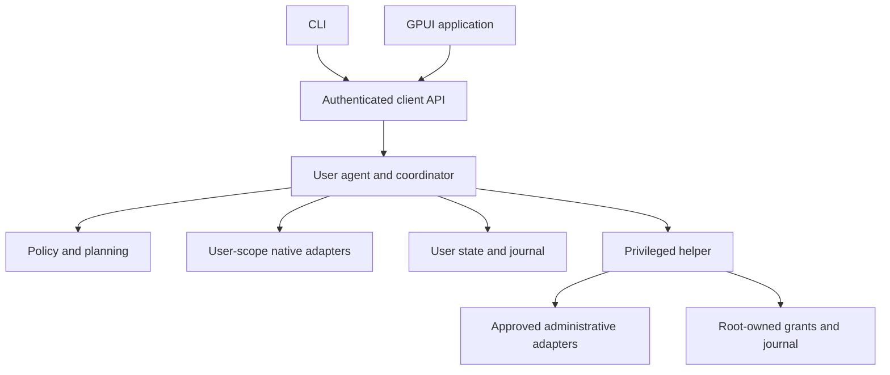
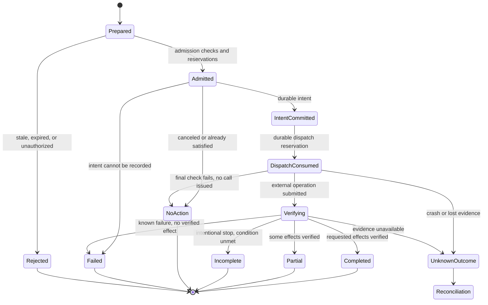

# Svalnir Architecture

**Status:** Design baseline. The repository currently contains project documentation and a skeleton Cargo workspace with no product behavior; the components, protocols, and guarantees described here are requirements for implementation, not claims about a shipped executable.

**Last reviewed:** 2026-11-16

This document defines how Svalnir observes macOS resource use, decides whether intervention is authorized, executes bounded actions, and reports their outcomes. Product scope and illustrative commands are in [README.md](../README.md). Repository working instructions are in [AGENTS.md](../AGENTS.md) and [CONTRIBUTING.md](../CONTRIBUTING.md).

This document owns component boundaries and cross-component invariants. The [design specifications table](../README.md#design-specifications) lists the owner of each detailed contract. The owning specification takes precedence where this overview is less specific. A change to a contract must update its owner and this overview in the same change.

## 1. Goals and architectural invariants

The architecture must preserve these invariants:

1. **One execution authority.** CLI and GUI use the same agent, policy evaluation, action coordinator, and history.
2. **Observation remains responsive.** An application waiting to exit must not stall sampling, cancellation, or policy changes.
3. **Access and authorization are separate.** OS permissions enable access; product authorization selects permitted actions; administrator-approved ceilings constrain the privileged helper.
4. **Identity is checked at execution.** A displayed path, PID, cached scan, or old plan is insufficient authority for a later mutation.
5. **Every action is bounded.** Rules constrain targets, duration, byte or application budgets, escalation, retries, and incident frequency.
6. **Uncertainty is preserved.** Missing measurements, estimated reclaim, partial effects, and unknown outcomes remain distinguishable.
7. **Filesystem mutation requires durable intent.** This includes Trash moves. Process intervention has a separate, explicitly configured critical-pressure exception.
8. **Recovery does not replay blindly.** A database transaction cannot make a filesystem operation or signal part of the same atomic commit.
9. **The observer remains inexpensive.** Queues, scans, databases, retained samples, and emergency work have resource limits.

These invariants govern new integrations as well as the initial disk and memory guards.

## 2. Components and dependency direction

The Cargo workspace contains five crates under `crates/`. `svalnir-cli` implements the argument and output contract of [INTERFACES.md](INTERFACES.md), and the other crates are placeholders; the table gives the intended responsibilities, which are not yet implemented.

| Component | Responsibilities | Must not own |
| --- | --- | --- |
| `svalnir-core` | Typed identities and units; accounting; pure policy evaluation; rule, plan, action, and journal contracts | GPUI, launchd lifecycle, direct deletion or signaling |
| `svalnir-agent` | Collection; candidate catalog; controller; action coordination; user-scope adapters; local client API | Arbitrary root execution or rendering |
| `svalnir-privileged` | Independently validated administrative operations; helper-owned grants and journal; host resource leases | User-controlled policy interpretation as root authority |
| `svalnir-cli` | `clap` parsing, completions, presentation, structured output, client requests | An independent destructive execution path |
| `svalnir-gui` | GPUI views, interaction, notifications, client-side view state | Policy enforcement or blocking native work on the UI thread |

The agent, helper, and clients depend on relevant core contracts. The core does not depend on those executables. macOS bindings initially live in focused internal platform modules; extracting another crate requires a concrete ownership or reuse benefit.

Native adapters isolate `unsafe` and FFI, including ownership, callback lifetime, thread-affinity, and error conversion. Policy evaluators accept values and return decisions; effects happen through injected interfaces. The headless agent must build without GPUI rendering dependencies.



The graph shows runtime responsibility, not permission inheritance: granting access to one process does not establish access for another.

## 3. Runtime and coordination

A user-session LaunchAgent owns routine monitoring. Closing the CLI or GUI leaves it running while the session and machine state permit. The optional system helper provides supported administrative operations and arbitration between cooperating Svalnir sessions.

The agent separates:

- **Collectors:** bounded resource sampling, filesystem invalidations, process lifecycle observations, and capability probes.
- **Controller:** deterministic policy evaluation and incident state.
- **Coordinator:** resource leases, plan lifecycle, cancellation, dispatch, and reconciliation.
- **Executors:** bounded filesystem or application operations.
- **Persistence and delivery:** journal transactions, retained observations, and client subscriptions.

The initial implementation permits one intervention action at a time per user agent. Observation and control messages remain concurrent. Short scheduling locks must never be held while waiting for an application, native callback, or storage operation.

Conflicts are keyed by resource identity, including process generation, cleanup root, and APFS capacity domain. The helper brokers host-wide leases for shared domains. Multiuser automatic shared-volume cleanup requires that broker; without it, deployment must explicitly restrict automation to a single-user mode or remain observational for affected domains.

Leases serialize cooperating Svalnir instances. They do not lock out other applications or make filesystem contents immutable. Expired leases require reconciliation of an outstanding action before another conflicting dispatch; expiry alone is not proof that work stopped.

## 4. Domain model and identities

All boundary types are versioned. Units and observation quality are explicit rather than encoded in field names alone.

| Type | Required meaning |
| --- | --- |
| `Observation<T>` | Value or unavailable state with reason; source; units; coverage; monotonic acquisition window; boot and collector epoch. Consumers derive freshness; it is not a stored flag |
| `VolumeIdentity` | Stable filesystem identity where available, mount generation, and the relevant capacity domain |
| `FileIdentity` | Approved root identity, relative entry, filesystem and file identifiers where supported, type, owner, and required adapter metadata |
| `ProcessIdentity` | PID, start identity, owner, executable/application association, and boot/session context |
| `ApplicationIdentity` | Verified application or managed-job association and explicitly attributed members |
| `PolicyRevision` | Validated desired/effective user policy and revision identifier |
| `ActionGrant` | Standing product authorization for action classes, targets, rules, escalation, and budgets |
| `PrivilegeGrant` | Helper-owned administrator-approved ceiling, principal, scope, limits, and revocation generation |
| `ActionPlan` | Immutable targets, rule versions, preconditions, estimates, limits, expiry, and policy/grant revisions |
| `OperationId` | Opaque correlation and deduplication identity; not an authorization capability by itself |
| `ResourceLease` | Coordinator-issued ownership of a conflict domain for bounded work |

An identity must record which native evidence was available. An absent generation identifier must not be invented. Display paths and process names are labels; they are never sufficient target selectors.

Use monotonic time for sustain periods, rate calculations, deadlines, and cooldowns within a running epoch. Wall-clock time supports human history. After restart or wake, invalidate observations and timing assumptions that cannot be established reliably.

## 5. Observation and accounting

### Disk and filesystem state

Maintain separate values for logical size, allocated size, estimated reclaimable bytes, bytes moved to Trash, and observed available-capacity change. Hard links, clones, snapshots, and open files prevent simple addition from proving physical reclamation.

A native capacity adapter can derive available bytes from `statfs` fields and expose Foundation capacity estimates separately. APFS volumes that share container capacity must not each contribute that capacity to a summed total. Preserve measurement scope, source, and timestamp. [Apple's filesystem statistics][statfs], [capacity guidance][capacity], and [APFS volume documentation][apfs] define the relevant platform concepts.

Incremental scans use bounded batches and cancellation. FSEvents marks catalog regions dirty; it is not a complete audit log. Dropped/coalesced events and root changes require reconciliation, following [Apple's FSEvents guidance][fsevents]. A stale catalog may support display, but mutation requires fresh target checks.

Candidates are prepared during ordinary operation. Critical disk pressure must not trigger a whole-disk scan, duplicate hashing, database vacuum, or unbounded cleanup discovery.

### Memory, swap, and application state

Collect native memory-pressure events and bounded samples. Keep system pressure, physical footprint, RSS, compressor statistics, swap occupancy, and swap activity distinct. Record runtime page size and counter discontinuities; page-in/out activity must not be relabeled as swap activity without the appropriate source.

Unavailable process or system metrics remain unavailable. Process totals must not pretend to be an exact decomposition of system memory. Increasing footprint is evidence of growth, not proof of a leak. Platform sources include [Dispatch memory pressure][pressure], [Apple's footprint guidance][footprint], and [XNU VM statistics definitions][vm-statistics].

### Capability state

Track each required operation/resource as available, denied, unsupported, or unknown under the identity of the process that will perform it. A capability can disappear between probe and action.

There is no supported universal Full Disk Access (FDA) confirmation API; actual-resource access is the relevant check. Reading TCC databases or successfully probing an unrelated file cannot establish universal access. [Apple DTS explains this limitation][fda]. Permission diagnostics must not infer service access from Terminal access.

## 6. Policy evaluation and incident control

The pure evaluator receives a policy revision, applicable grants, fresh observations, candidate summaries, active incidents, and prior outcomes. It returns a decision with reasons, required evidence, bounds, and stop conditions. It never deletes or signals.

Three trigger paths remain distinct:

| Trigger | Admission conditions | Response |
| --- | --- | --- |
| Disk pressure | Authorized volume/domain, sustained capacity threshold, approved eligible candidates | Bounded cache eviction batches |
| Global memory pressure | Fresh sustained critical-pressure evidence and eligible applications | One application intervention, then observation |
| Application budget | Verified application attribution and sustained configured stop-budget violation | That application's authorized stop policy |

High RAM utilization, nonzero swap, CPU load, or a large process alone does not select an application for termination. A soft application threshold is advisory. CPU measurements may explain contention; CPU-based termination requires a separately specified policy.

Incidents move through observation, eligibility evaluation, intervention, post-action observation, recovery, and cooldown. Use separate entry/recovery thresholds, sustained windows, per-pass limits, per-incident application limits, restart cooldowns, and no-effect backoff. Values in the README are illustrative, not production defaults.

When disk and memory pressure coexist, the coordinator selects bounded work that fits both budgets. Memory intervention must not wait for an expensive scan, and eviction must account for rebuild cost or immediate cache regrowth. Stop when observations become unreliable, authority changes, budgets expire, recovery is sustained, or available actions fail to help.

## 7. Planning and execution contract

Manual requests and automatic policies converge on the same plan and executor. A preview explains a snapshot; it is neither a reservation nor a guarantee that the target will remain eligible.

A plan binds targets to verified identities, rule versions, the effective policy, applicable grant generations, expiry, budgets, and executor role. Clients submit plan IDs; the server resolves stored plan contents. Client-supplied replacement paths or target expansions are rejected.

Before every action or batch, the coordinator:

1. Checks freshness, cancellation, pause state, revisions, and remaining incident budget.
2. Acquires the required leases and revalidates target identity, scope, exclusions, and adapter conditions.
3. Records intent in the executor's operation journal, durably except for the explicitly authorized critical-memory exception in section 12.
4. Marks the dispatch as consumed before issuing the external operation, with the same durability requirement and exception.
5. Executes one bounded step, observes effects, and records the outcome.
6. Remeasures resources before proposing another step.

Immediately before the external call, the executor checks cancellation, grant generation, and target validity again. A change after reservation but before the call stops that dispatch and records that no effect was issued. This check still does not make a later OS operation atomic with validation.

The helper repeats the checks relevant to its own authority and writes its own intent; an agent journal cannot substitute for the helper's record.



This diagram is a summary of the normal durable path. [ACTION_CONTRACTS.md](ACTION_CONTRACTS.md) owns the state definitions and the aggregation rules. Intent, dispatch consumption, and verification apply to each executable step. The settled states describe a step and, through the aggregation rules, its operation. A rejected request creates no operation. The critical-memory exception in section 12 uses explicitly marked volatile intent and dispatch records; it must never report those records as durably committed. Cancellation before dispatch can finish without effects; cancellation after dispatch stops subsequent work and reports any completed or uncertain effects.

A consumed request is single-use. Duplicate requests return known status or require reconciliation. A crash after dispatch reservation may leave no effect, a completed effect, or a partial effect; Svalnir must not promise exactly-once external execution.

## 8. Filesystem action adapters

Each cleanup rule is a reviewed, versioned adapter with:

- Explicit roots and supported filesystem conditions.
- File types, ownership, age, and regenerability requirements.
- Activity/quiescence or owner-protocol checks.
- Exclusions, rebuild consequences, and evidence of namespace safety.
- Candidate and batch bounds, cancellation points, and outcome semantics.

Directory naming alone does not prove that data is disposable. Documents, Downloads, media libraries, backups, Xcode archives/dSYMs, model weights, databases, complete application containers, and swap files remain outside generic automatic eviction.

Ordinary user-cache actions execute with the owning user's privileges. Initial root-executed deletion is restricted to helper-owned data or specifically reviewed administrator-controlled disposable namespaces. The helper is not a root override for arbitrary user-writable trees.

Traversal must anchor approved roots, reject unexpected links, mounts, types, and ownership changes, and use descriptor-relative operations where appropriate. However, checking an identity and later unlinking a directory entry does not make those steps atomic. Rename-to-quarantine also changes the source before post-move verification. [Apple's unlink contract][unlink] supports no general conditional-delete guarantee.

Before unattended mutation is enabled, the adapter must document and test its namespace and ownership protocol. An explicitly authorized disposable-namespace contract may accept documented residual risk within demonstrated confinement; authorization alone does not establish confinement. An uncontrolled namespace without that evidence remains ineligible. Open-file scans or advisory locks alone are not universal proof of inactivity.

Manual removal defaults to a supported Trash operation where available. Automatic permanent eviction requires its own standing authorization. Never silently convert a failed Trash move into deletion, empty the user's entire Trash, or report moved bytes as reclaimed space.

After each bounded batch, record per-target effects and measure capacity again. Observed capacity change can include concurrent activity; it is not exact causal attribution to Svalnir.

## 9. Application intervention

Application control operates on verified application or managed-job identity. Parentage, matching names, shared XPC services, and process groups do not by themselves establish ownership.

The initial sequence is:

1. Refresh target identity, owner, eligibility, foreground status, protection rules, grant, and incident bounds.
2. Request the supported graceful termination. A cooperative operation, such as a model unload, is available only through a typed adapter with its own completion predicate; it is not one of the five initial action classes.
3. Wait asynchronously for exit or the configured deadline while continuing observation.
4. Revalidate before force escalation; force only if the standing policy permits it.
5. Verify exit, distinguish relaunch from the original process generation, and observe resource pressure before selecting another application.

A separately authorized disposable-job policy may permit immediate force. Critical system identities and Svalnir's own control plane remain hard protected. Balanced policy protects the foreground application. Cross-user, root, and system-process control is outside the initial helper surface.

Submitting a termination request is different from observing exit. Report already-exited targets, refusal, timeout, identity replacement, force submission, verified exit, and unknown outcome separately. [NSRunningApplication termination APIs][terminate], [force termination][force-terminate], and [exit state][is-terminated] inform the adapters.

For PID-based control, use positive individual PIDs and fresh start/owner/executable checks. A check followed by `kill` is not an atomic signal-to-generation operation; the implementation must document its remaining race window. [Apple's kill interface][kill] does not establish a Linux-style pidfd guarantee.

Force quit can lose unsaved work. Standing policy must make that consequence and its target scope explicit. Do not implement memory recovery by deleting swap files, disabling swap, generic RAM purging, or suspending applications. Per-app budgets are controller policies, not hard kernel memory quotas.

## 10. Local IPC contract

The signed distribution uses authenticated local XPC endpoints. Select supported public code-identity APIs against the deployment target; `NSXPCConnection.setCodeSigningRequirement` is documented for macOS 13 and later and must be configured before resuming the connection. [Apple's API contract][xpc-requirement] also requires handling malformed requirements and identity failures.

Validate both client and server identities using the expected product signing identifiers and signer requirements. Team identity alone is too broad. Enforce verified user/session identity and protocol role with supported platform metadata. Never derive authority from caller-provided UID or PID fields.

The conceptual API separates:

| Family | Examples of responsibility |
| --- | --- |
| Observation | Bounded snapshots, scan status, resource samples, operation status |
| Planning | Candidate selection, plan preparation, preview reasons |
| Control | Apply/cancel a plan, pause automation, activate policy |
| Authorization | Establish or revoke supported grants through the appropriate authority |
| Events | Sequence-numbered updates with gap detection and resynchronization |

Negotiate protocol version and capabilities. Reject incompatible mutation requests and unknown authority-bearing fields. Bound payload size, collection counts, nesting, in-flight requests, queue depth, and subscription backlog. Slow clients lose old telemetry and request a fresh snapshot; they must not stall control or retain unlimited history.

Authenticate sensitive read endpoints as well as mutation endpoints. FDA-bearing services must not expose arbitrary file reads or unrestricted enumeration through a diagnostic API.

A development socket, if needed before signed XPC integration, is limited to observation and disposable-fixture execution. It must not become a permissive production root endpoint. Client disconnection does not imply cancellation: clients can reconnect by operation ID, and explicit cancellation has defined acknowledgement semantics.

## 11. Authorization and the privileged boundary

Three records have different authority:

| Record | Owner and purpose | Security limit |
| --- | --- | --- |
| `PolicyRevision` | User-session desired/effective behavior | Cannot grant OS access or broaden helper limits |
| `ActionGrant` | Standing product consent for specified actions | Same-user state; not independent proof of human intent |
| `PrivilegeGrant` | Helper-owned administrator-approved limits | Enforced independently of caller policy, paths, catalogs, and metrics |

The helper accepts typed operations, never shell text, arbitrary scripts, caller-selected executables, or unrestricted recursive deletion. It re-resolves targets, validates its own grant generation and ceilings, and independently verifies any condition that would widen privileged authority. Caller-supplied pressure evidence cannot unlock additional root powers.

Grant establishment or expansion uses a separately reviewed administrative authorization flow. Background-item approval, administrator authorization, FDA, Automation, and Accessibility remain separate capabilities. Authorization Services does not replace TCC; root does not bypass SIP. See [Authorization Services][authorization], [SMAppService][smappservice], and [SIP][sip].

Signing proves executable identity, not human intent. Same-user malware can invoke a genuine signed CLI or alter user-owned state. The helper therefore confines the effect of an accepted request instead of treating the CLI signature as universal consent.

Pause or revocation inhibits new dispatch and the next action step once observed. It cannot undo an issued syscall. A durable-success acknowledgement requires persistent revocation first. If persistence fails, inhibit current-instance work and report a non-durable/degraded result; an earlier durable configuration may return after restart. Never promise that an unpersisted pause survives a crash.

## 12. Persistence and crash recovery

The user configuration location remains:

```text
~/Library/Application Support/Svalnir/config.toml
```

The proposed state layout separates rebuildable catalog/telemetry storage from `operations.sqlite`, which holds action intents, dispatch state, outcomes, and links to the effective policy/grant revisions. Activated revisions needed to interpret actions must be retained with the journal; merely editing the TOML file does not acknowledge activation.

Helper grants and its operation journal live in a separately protected, root-owned namespace under `/Library/Application Support/Svalnir/`. The helper must not consume a user-owned SQLite file or follow user-controlled links to load authoritative state.

For the operation journal, the baseline is SQLite WAL with `synchronous=FULL`, explicit verified writer settings, bounded transactions, and controlled checkpointing. macOS `fullfsync` is a separate setting; `FULL` alone does not imply `F_FULLFSYNC`. The exact VFS/build/settings combination requires native durability validation. Catalog and telemetry retention may use weaker durability because those records are reconstructible. [SQLite documents these distinctions][sqlite-pragma] and [WAL behavior][sqlite-wal].

Bound the database, WAL, exports, and temporary storage. Reserve capacity or preallocation may improve availability, but cannot guarantee the next write on a full or copy-on-write filesystem. Keep checkpoints and maintenance out of emergency paths without allowing unbounded WAL growth; stop admission when limits cannot be preserved.

### Journal failure

Filesystem actions, including Trash moves, fail closed if durable intent or dispatch reservation cannot be committed. Process termination also requires durable recording by default.

The sole planned exception is `allow_volatile_journal_on_critical`: when explicitly enabled in advance, fresh sustained global critical-memory pressure may authorize otherwise eligible automatic termination with a bounded in-memory record if durable storage fails. It does not apply to filesystem mutation, manual process control, or the independent per-app budget trigger. It cannot expand target, escalation, or helper grants.

For this exception, intent and dispatch consumption are recorded together in bounded volatile state before submission. Duplicate requests remain consumed within that executor epoch, and requests from an earlier epoch cannot be replayed. The same rule applies to any executor participating in the exception.

Report degraded auditability and persist the record later if possible. A crash can lose it, including incident counts retained only in memory. If a restart cannot establish that the prior incident and budget state were preserved, treat the affected incident budget as exhausted until fresh observations establish sustained recovery and a new incident, or the user explicitly rearms it. Restarting Svalnir must not silently replenish an unknown budget during continuing pressure. Volatile mode cannot promise complete accounting across crashes.

`SQLITE_FULL`, including temporary-file exhaustion, must be handled explicitly. [SQLite error documentation][sqlite-full] defines the storage failure.

### Restart

On startup, inspect incomplete operations before admitting conflicting work. Reconcile available file/process evidence without assuming that the external action happened or did not happen. Preserve `UnknownOutcome` when evidence cannot settle it. Do not delete again or terminate a replacement process to make a historical record look complete.

## 13. CLI and GPUI behavior

The CLI uses `clap` and `clap_complete`; the GPUI client uses the pinned GPUI revision. Both translate user intent into the same typed API. See the [clap documentation][clap] and [GPUI build requirements][gpui].

Structured stdout contains only the versioned machine-readable result or stream. Diagnostics and progress belong on stderr. Reports expose units, quality, policy reasons, estimates, effects, and incomplete results. [INTERFACES.md](INTERFACES.md) specifies the proposed exit-status, JSON, and NDJSON contracts; they are not stable until the validation in that document is complete.

GPUI views consume immutable snapshots and asynchronous updates. Native collection, scans, and IPC waits run away from the rendering thread. Reconnection refreshes state after sequence gaps. Accessibility labels, keyboard operation, and unavailable/loading/error states are part of the client contract.

Neither client invents successful completion from a dispatched request. History and notifications describe observed outcomes, including partial completion and force escalation.

## 14. Lifecycle, packaging, and upgrades

A signed bundle uses `SMAppService` for its own background components on macOS 13 or later. An early CLI package may instead install an explicitly managed conventional LaunchAgent. These are packaging alternatives, not two concurrent agents. [Apple's service-management documentation][smappservice] and [launchd guidance][launchd] define the integration.

Start with fresh capabilities, identities, and samples. After wake, reconcile mounts/processes, reset discontinuous counters and sustain windows, and invalidate stale plans. Monitoring does not run continuously during sleep and must not keep the Mac awake merely to poll.

Respect user-disabled background items. Service failure produces degraded capability and restart backoff; it must not silently re-enable a user-disabled component.

Upgrade handling must quiesce new mutations, resolve or preserve in-flight state, validate protocol compatibility, and apply versioned migrations. Storage-constrained startup must not attempt an unbounded migration or silently discard the journal. An older binary must reject an incompatible state version safely. Rollback of binaries does not imply rollback of performed actions.

The supported macOS minimum, hardware matrix, Rust toolchain, GPUI revision, signing requirements, and packaging channel remain release decisions. macOS 13 availability of selected APIs is not a claim that every dependency supports that deployment target.

## 15. Failure behavior

| Condition | Required behavior |
| --- | --- |
| Stale/denied measurement | Display quality; inhibit actions whose admission depends on that evidence |
| Root, file, mount, or process identity changes | Reject or stop the affected step; rebuild the plan if appropriate |
| User pauses or changes policy | Inhibit subsequent dispatch under the old revision; report in-flight effects |
| Helper unavailable | Continue permitted observation/user work; disable unsupported privileged or multiuser-coordinated work |
| Application refuses to exit | Escalate only within current authorization and limits; otherwise report timeout |
| Journal write/sync fails | Block filesystem mutation; apply only the separately authorized critical-memory exception |
| Capacity does not improve | Record measured result; apply no-effect backoff and incident limits |
| Client disappears | Continue admitted bounded work unless explicitly canceled; retain queryable status |
| Crash during an external operation | Reconcile; preserve partial/unknown outcome; no blind replay |
| Queue or storage bound reached | Shed reconstructible telemetry first; preserve control responsiveness and action admission limits |

## 16. Verification and unresolved release decisions

Native integration evidence must accompany implementation. [VALIDATION.md](VALIDATION.md) owns the validation families, release gates, and evidence records; the list below is a summary.

Required validation includes deterministic policy replay, simultaneous disk/memory incidents, namespace replacement and mount races, stale-PID/relaunch behavior, foreground/protected targets, signed IPC authorization and replay, per-component permission revocation, cross-session lease recovery, and crashes at every journal/action boundary.

Use disposable filesystem fixtures, controlled child applications, injected pressure, and isolated privileged test environments. Tests must not exhaust a developer's real disk/RAM or target unrelated applications.

Before enabling unattended mutation, record:

- The supported OS/SDK/API matrix and actual target-binding guarantees.
- Each cleanup adapter's regenerability, activity, and namespace-safety evidence.
- The code-signing requirements, helper grant schema, and administrative flow.
- Journal durability settings, bounded-storage behavior, and recovery results.
- Policy defaults and measured budgets for idle CPU, memory, I/O, scan work, and intervention latency.
- Upgrade, uninstall, service-disable, and permission-degradation behavior.

Complete protocol schemas and the implemented rule registry will be published with the implementation. A change to a contract in this document must also update the owning specification and the corresponding threats.

## Primary references

- Storage: [filesystem statistics][statfs], [capacity estimates][capacity], [APFS][apfs], [FSEvents][fsevents], and [unlink semantics][unlink].
- Memory and processes: [pressure events][pressure], [footprint][footprint], [VM statistics][vm-statistics], [termination][terminate], [force termination][force-terminate], [exit state][is-terminated], and [signals][kill].
- Authority: [XPC peer requirements][xpc-requirement], [Authorization Services][authorization], [FDA limitations][fda], and [SIP][sip].
- Persistence: [SQLite settings][sqlite-pragma], [WAL][sqlite-wal], and [storage errors][sqlite-full].
- Runtime and clients: [SMAppService][smappservice], [launchd][launchd], [clap][clap], and [GPUI][gpui].

[statfs]: https://developer.apple.com/library/archive/documentation/System/Conceptual/ManPages_iPhoneOS/man2/statfs.2.html
[capacity]: https://developer.apple.com/documentation/foundation/checking-volume-storage-capacity
[apfs]: https://support.apple.com/en-ie/guide/disk-utility/dskua9e6a110/mac
[fsevents]: https://developer.apple.com/library/archive/documentation/Darwin/Conceptual/FSEvents_ProgGuide/UsingtheFSEventsFramework/UsingtheFSEventsFramework.html
[pressure]: https://developer.apple.com/documentation/dispatch/dispatch_source_type_memorypressure
[footprint]: https://developer.apple.com/videos/play/wwdc2022/10106/
[vm-statistics]: https://github.com/apple-oss-distributions/xnu/blob/main/osfmk/mach/vm_statistics.h
[fda]: https://developer.apple.com/forums/thread/835851
[unlink]: https://developer.apple.com/library/archive/documentation/System/Conceptual/ManPages_iPhoneOS/man2/unlink.2.html
[terminate]: https://developer.apple.com/documentation/appkit/nsrunningapplication/terminate()
[force-terminate]: https://developer.apple.com/documentation/appkit/nsrunningapplication/forceterminate()
[is-terminated]: https://developer.apple.com/documentation/appkit/nsrunningapplication/isterminated
[kill]: https://developer.apple.com/library/archive/documentation/System/Conceptual/ManPages_iPhoneOS/man2/kill.2.html
[xpc-requirement]: https://developer.apple.com/documentation/foundation/nsxpcconnection/setcodesigningrequirement(_:)
[authorization]: https://developer.apple.com/documentation/security/authorization-services
[smappservice]: https://developer.apple.com/documentation/servicemanagement/smappservice
[sip]: https://support.apple.com/en-sg/102149
[sqlite-pragma]: https://www.sqlite.org/pragma.html
[sqlite-wal]: https://www.sqlite.org/wal.html
[sqlite-full]: https://www.sqlite.org/rescode.html#full
[clap]: https://docs.rs/clap/latest/clap/
[gpui]: https://github.com/zed-industries/zed/blob/main/crates/gpui/README.md
[launchd]: https://developer.apple.com/library/archive/documentation/MacOSX/Conceptual/BPSystemStartup/Chapters/CreatingLaunchdJobs.html

